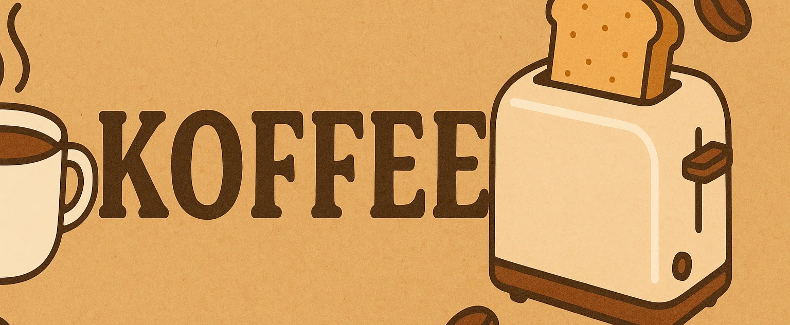
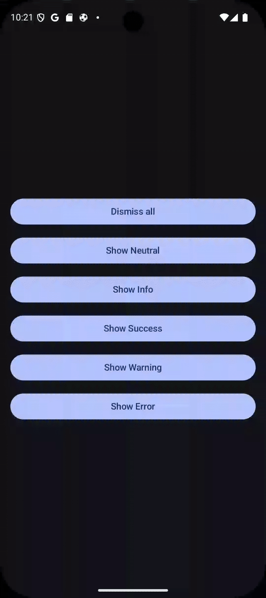

<!-- Banner -->  
<p align="center">
  
</p>

  [](https://search.maven.org/artifact/io.github.donald-okara/koffee)
<h1 align="center">☕ Koffee</h1>  

<p align="center">  
  A lightweight, animated toast system for Jetpack Compose.    
  Serve your toasts hot, cold, or custom brewed.  
</p>  

> 🙌 Want to contribute? Check out our [Contribution Guidelines](CONTRIBUTIONS.md).

> 💬 Have feedback? Share it on [Featurebase](https://koffee.featurebase.app).

---  

## ✨ Features

> ⚠️ Koffee is currently unavailable for iOS. Please feel free to submit a PR for this

- 🍞 Simple toast host & state management
- 🪄 Animated entrance/exit with layout awareness
- 🧊 Supports multiple types of toasts: Info, Success, Error, etc.
- 🧩 Plug-and-play composables for custom toast UIs
- 🔧 Customizable positioning, dismissal, durations
- 🪶 Lightweight with zero dependencies

---  

## 📱 Demo

This is a demo of how Koffee works. The toasts are swipeable.

<p align="center">
  
</p>


---
## 🛠 Installation

**📦 Now available on Maven Central**

> Koffee is now published to Maven Central. The last JitPack release will remain available but **will no longer be updated**.

### Maven Central (Recommended)

```kotlin
// settings.gradle.kts
dependencyResolutionManagement {
    repositoriesMode.set(RepositoriesMode.FAIL_ON_PROJECT_REPOS)
    repositories {
        google()
        mavenCentral() // ✅ Primary distribution
    }
}
```

```kotlin
// module build.gradle.kts
dependencies {  
    implementation("io.github.donald-okara:koffee:<latest version>") // Replace with the latest version
}  
```

[](https://search.maven.org/artifact/io.github.donald-okara/koffee)

---

<details>
<summary>JitPack (Legacy)</summary>

```kotlin
// settings.gradle.kts
dependencyResolutionManagement {
    repositoriesMode.set(RepositoriesMode.FAIL_ON_PROJECT_REPOS)
    repositories {
        google()
        maven(url = "https://jitpack.io") // ⚠️ Legacy – no longer updated
    }
}
```

```kotlin
// module build.gradle.kts
dependencies {  
    implementation("com.github.donald-okara:koffee:0.0.4") // Last JitPack version
}  
```

[](https://jitpack.io/#donald-okara/koffee)

</details>

---  
## 🧱 Architecture

Koffee has 3 layers:
1. **Koffee.init** – Configure default behavior.
2. **Koffee.Setup** – Renders and animates toast layouts.
3. **Koffee.show** – Triggers new toasts globally.

You can plug in your own toast layouts, define duration policies, and limit how many are shown at once.

---
## 🚀 Getting Started

### Step 1: Initialize Koffee
> As of Koffee v0.1.0, we have a new way to initialize Koffee. 

Wrap your root (or target) layout to configure Koffee in one place — stable across recompositions.

#### Easy setup

```kotlin
KoffeeBar(
    modifier = Modifier.fillMaxSize(),
    config = myConfig,
) {
    NavHost()
}

```

#### For nerds

```kotlin
@OptIn(ExperimentalKoffeeApi::class)
val myConfig = remember {
    KoffeeDefaults.config.copy(
        layout = { GlowingToast(it) },
        dismissible = true,
        maxVisibleToasts = 3,
        position = ToastPosition.BottomCenter,
        animationStyle = ToastAnimation.SlideUp,
        durationResolver = ::customDurationResolver,
    )
}

fun customDurationResolver(duration: ToastDuration): Long? = when (duration) {
    ToastDuration.Short -> 5000L
    ToastDuration.Medium -> 7000L
    ToastDuration.Long -> 10000L
    ToastDuration.Indefinite -> null
}

KoffeeBar(
    modifier = Modifier.fillMaxSize(),
    config = myConfig,
) {
    NavHost()
}
```

The old method is not deprecated yet. See it below.

---

<details>
<summary>Koffee.Setup and Koffee.init{} (Legacy)</summary>
> This goes in your application class or MainActivity onCreate

```kotlin  
override fun onCreate() {  
    super.onCreate()  
  
    Koffee.init {  
        layout { DefaultToast(it) } // or custom. DefaultToast() is our in built default toast composable 
        dismissible(true)  
        durationResolver { customDurationResolver(it) }  
    }
}

private fun customDurationResolver(duration: ToastDuration): Long? = when (duration) {  
    ToastDuration.Short -> 5000L  
    ToastDuration.Medium -> 7000L  
    ToastDuration.Long -> 10000L  
    ToastDuration.Indefinite -> null  
}
```  

> Hint: You can use Koffee.init{} with an empty lambda as there are default values for everything
### Step 2: Add Koffee.setup

> This goes in your root composable

```kotlin  
Scaffold(modifier = Modifier.fillMaxSize()) { innerPadding ->  
    Box(  
        contentAlignment = Alignment.Center,  
        modifier = Modifier.padding(innerPadding),  
    ) {  
        // 1. Your app UI  
        TestToasts()  
  
        // 2. Render Koffee  
        Koffee.Setup(  
            maxVisibleToasts = 2,  
        )  
    }  
}
```  

</details>

### Step 2: Show toast

> You can call Koffee.show from anywhere as long as a host is attached (via KoffeeBar or Koffee.Setup).
### Minimal Setup

Wrap your screen content with `KoffeeBar` using defaults:

```kotlin
KoffeeBar {
    MyScreenContent()
}
```

Show a simple toast anywhere within a screen attached to a `ToastHostState`:

```kotlin
Button(
    onClick = {
        // Koffee.show can be called from ViewModels, Repositories, anywhere your screen has a ToastHostState
        Koffee.show(
            title = "Success toast",
            description = "This is a green notification"
        )
    }
) {
    Text("Hello fam")
}
```

---

### Optional Advanced Toast Control

Customize layout, animation, position, duration, and other properties:

```kotlin
val mySimpleConfig = remember {  
    KoffeeDefaults.config.copy(  
        layout = { GlowingToast(it) },  // Pass your preferred toast composable here: @Composable (ToastData) -> Unit
        dismissible = true,  
        maxVisibleToasts = 3,  
        position = ToastPosition.BottomCenter,  
        animationStyle = ToastAnimation.SlideUp,  
        durationResolver = ::customDurationResolver,  
    )  
}

KoffeeBar {
    MyScreenContent()
}
```

Use a toast with actions:

```kotlin
Koffee.show(
    title = "Success toast",
    description = "With actions",
    type = ToastType.Success,
    primaryAction = ToastAction(
        label = "Share",
        onClick = { println("Viewing info details") },
        dismissAfter = true
    ),
    secondaryAction = ToastAction(
        label = "Copy",
        onClick = { println("Copied!") },
        dismissAfter = true
    )
)
```
---  

## 🔧 Customization

You can pass your own Composable to style the toast as long as its signature matches

```kotlin  
@Composable (ToastData) -> Unit
```  

---  

## 🙏 Credits

Built with love for Jetpack Compose devs who want more control over their UI.    
Made by [@donald-okara](https://github.com/donald-okara)

> Looking for feature X? [Open an issue](https://github.com/donald-okara/koffee/issues)

## 📜 License

Koffee is licensed under the [Apache License 2.0](https://www.apache.org/licenses/LICENSE-2.0). You’re free to use, modify, and distribute it under the conditions specified.
